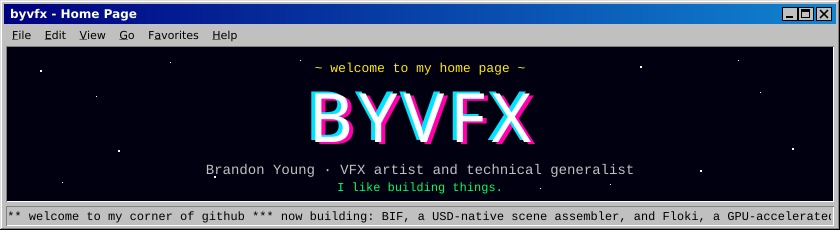

  

### About me

I'm a tool builder with a background in VFX. I design and build software for media and production work: image viewers, scene assembly, command-line utilities, and automated pipelines that run unattended.

My focus is on tools that are simple to deploy, clear about their failures, and reliable in daily use.

Python for tooling, automation, and ML. Go for fast CLIs and backend services. Rust where it earns its place.

### What's new

-  **[Clippa](https://github.com/byvfx/clipper)**: a stream clipping pipeline that records, transcribes, scores, cuts, reviews and publishes
-  **[Floki](https://github.com/byvfx/floki)**: a GPU-accelerated EXR viewer, eventually the 2D/color engine for BIF
-  **[comfyless](https://github.com/byvfx/comfyless)**: run ComfyUI workflows on cloud GPUs in your own Modal account
- **[BIF](https://github.com/byvfx/bif)**: a USD-native scene assembler
- **[go-notion-md-sync](https://github.com/byvfx/go-notion-md-sync)**: Notion pages and markdown files, kept in step

### Made with

  
  
  
  
  
  

### Links

  
  
  
  

### Guestbook

<!-- guestbook:start -->
- *no signatures yet: be the first*
<!-- guestbook:end -->

  <a href="https://github.com/byvfx/floki">← floki</a>
  &nbsp;·&nbsp; the byvfx webring &nbsp;·&nbsp;
  <a href="https://github.com/byvfx/bif">bif →</a>

